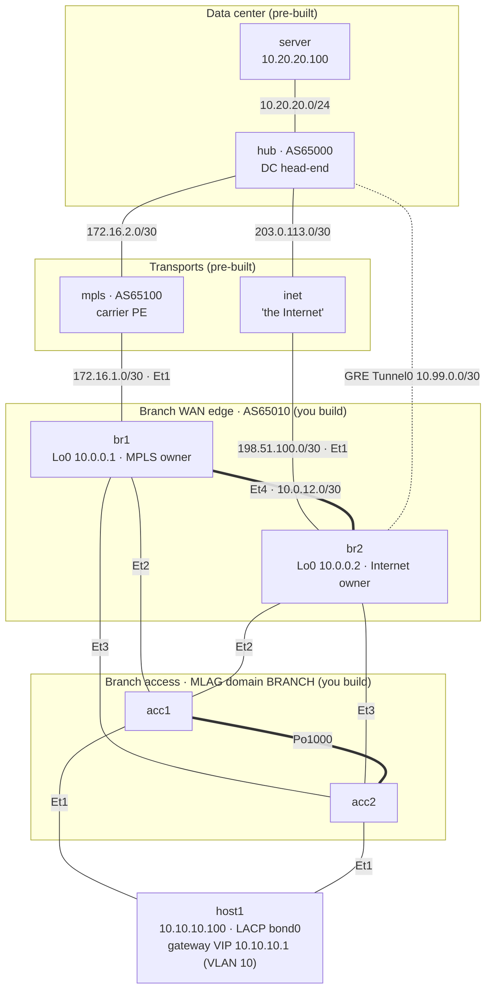

# HA Branch: Dual Router, Dual Transport — Capstone Lab

A remote branch built the way you'd build one that must not go down. There are
two routers, and each owns a different transport: `br1` has the carrier's
**MPLS** circuit and `br2` has an **Internet** circuit carrying a GRE overlay to
the data-center hub. Under them is an **MLAG** pair of access switches, so every
device has one leg on each switch. A cross-link plus iBGP lets either router
use either transport, and VRRP gives the users one gateway address. You build
all of that, then do the real HA work: **fail every component, one at a time,
predict what happens, and measure the outage**. The lab is finished when you can
explain every number in your failure matrix and you have closed the gaps it
exposed.

This is the hands-on counterpart to the classic "two routers, two circuits"
design used for enterprise WAN and SD-WAN branches. Commercial SD-WAN wraps the
same mechanics in a controller: dual edges, transport handoff via TLOC
extension, BFD probes per tunnel, and an app-aware path choice. Here you build
those pieces by hand, so you can see what the controller is doing.

**Before this lab:** `lacp-etherchannel`, `vrrp`, `bfd-bgp`, and ideally
`ha-network-design-ceos` (MLAG + VRRP in a campus). `sdwan-concepts` and
`service-ha` are good companions.

---

## Topology



Thick lines are the two "glue" links: the br1–br2 cross-link (iBGP) and the
acc1–acc2 MLAG peer-link (`Port-Channel1000` on Et4-5). Each router's Et2+Et3
form its `Port-Channel1`, with one leg on each access switch (switch side:
`Po11` for br1, `Po12` for br2), and host1's bond does the same (`Po10`). MLAG
makes the two switches look like one LACP partner. The dotted line is the GRE
overlay, which rides the Internet circuit.

### Link addressing

| Link | Subnet | Left side | Right side | Notes |
|------|--------|-----------|------------|-------|
| br1 Et1 — mpls eth1 | 172.16.1.0/30 | 172.16.1.1 (br1) | 172.16.1.2 (PE) | MPLS access circuit |
| br2 Et1 — inet eth1 | 198.51.100.0/30 | 198.51.100.1 (br2) | 198.51.100.2 (inet) | Internet circuit |
| hub eth1 — mpls eth2 | 172.16.2.0/30 | 172.16.2.1 (hub) | 172.16.2.2 (PE) | DC MPLS circuit |
| hub eth2 — inet eth2 | 203.0.113.0/30 | 203.0.113.1 (hub) | 203.0.113.2 (inet) | DC Internet circuit |
| br2 Tunnel0 — hub tun0 | 10.99.0.0/30 | 10.99.0.1 (br2) | 10.99.0.2 (hub) | GRE over the Internet |
| br1 Et4 — br2 Et4 | 10.0.12.0/30 | 10.0.12.1 (br1) | 10.0.12.2 (br2) | Router cross-link |
| br1/br2 Po1 (Et2-3) | 10.10.10.0/24 | 10.10.10.2 (br1) | 10.10.10.3 (br2) | VIP 10.10.10.1 |
| host1 bond0 (eth1-2) | 10.10.10.0/24 | 10.10.10.100 | — | LACP to acc1 Et1 + acc2 Et1 |
| acc1 Et4-5 — acc2 Et4-5 | VLAN 4094 10.255.254.0/30 | 10.255.254.1 (acc1) | 10.255.254.2 (acc2) | MLAG peer-link |
| hub eth3 — server eth1 | 10.20.20.0/24 | 10.20.20.1 (hub) | 10.20.20.100 (server) | DC LAN |

### Node reference

| Node | Platform | Loopback | Role | You configure? |
|------|----------|----------|------|----------------|
| br1 | cEOS 4.35.2F | 10.0.0.1/32 | Branch router, owns MPLS (AS65010) | **Yes** |
| br2 | cEOS 4.35.2F | 10.0.0.2/32 | Branch router, owns Internet + GRE (AS65010) | **Yes** |
| acc1 / acc2 | cEOS 4.35.2F | — | MLAG access pair | **Yes** |
| mpls | FRR | — | Carrier PE (AS65100): BGP + BFD to both sites already provisioned | No |
| inet | Linux | — | "The Internet": routes public addresses only | No |
| hub | FRR | — | DC head-end (AS65000): eBGP to PE + eBGP over GRE to br2, BFD, **no path policy** | No |
| host1 / server | Linux | — | Test endpoints | No |

The provider and hub use **BGP timers of 10 s keepalive and 30 s hold**, and
they already have **BFD enabled (300 ms × 3)** toward you. The branch must
match them, so read them as your carrier's provisioning letter.

### Failure domains: what this design is trying to survive

| Component | Redundant partner | Mechanism that hides the failure |
|-----------|-------------------|----------------------------------|
| A host or router LAN leg | The other leg to the other switch | LACP + MLAG |
| An access switch | The other access switch | MLAG |
| A router | The other router | VRRP (forward path) + BGP withdrawal (return path) |
| A transport | The other transport | BGP + BFD + the cross-link |
| The cross-link | ? (you find out in Task 7) | ? |

---

## How to use this lab

This is a **practice lab**, not a tutorial. Each task gives you an
**objective** and **hints** — your job is to produce the configuration.

- **Predict before you configure.** When a task asks for a prediction,
  commit to an answer before touching the CLI. Being wrong and finding out
  why is the point.
- **Open the hints before the solution.** The solution toggle is the answer
  key — use it to check your work or when genuinely stuck, not as step one.
- **Verify like an operator.** After each task, prove the state is what you
  think it is with `show` commands before moving on.

---

## Deploy

Images: `ceos:4.35.2F` (import it yourself: `docker import cEOS-lab-4.35.2F.tar ceos:4.35.2F`)
and `frr-lab:local` (`docker build -t frr-lab:local images/frr/`). Four cEOS nodes
need roughly 5 GB of RAM.

```bash
./scripts/lab.sh deploy ha-branch-dual-transport
```

```bash
./scripts/lab.sh cli ha-branch-dual-transport br1
```

```bash
./scripts/lab.sh bash ha-branch-dual-transport host1
```

Wait about 90 seconds after the deploy for EOS to finish booting. Helper
scripts live in the lab directory:

| Script | Purpose |
|--------|---------|
| `measure.sh --list` / `measure.sh <scenario>` | Inject one failure, measure the outage at 20 probes/s, trace both paths mid-failure, always restore |
| `check.sh` | Grade the finished (Task 8) state |
| `solution.sh [N]` | Answer key: apply the validated solution through task N |
| `break.sh` / `repair.sh` | Arm and undo the Task 9 fault |

### Platform notes (cEOS 4.35.2F in a container)

- **The tunnel double-forward fix is pre-installed.** In this virtual
  dataplane, a packet decapsulated from a GRE tunnel is forwarded twice: once
  by EOS and once by the Linux kernel underneath it. The host then sees every
  reply twice (`DUP!`). The topology's `exec` for `br2` adds one mangle-table
  rule that drops the kernel's copy. It is plumbing for this container image,
  not part of the lab; real EOS hardware does not need it.
- **There is no IP SLA in this cEOS build.** Object tracking can watch
  interface line-protocol only. Task 8 makes you design around that limit.
- **VRRP syntax** is `vrrp <id> ipv4 <vip>` and `vrrp <id> priority-level <n>`.
- **Traceroute hop 1 often shows `*`** when the VRRP master is the first hop.
  That is ICMP rate limiting, not a fault. Hop 2 tells you which transport
  you're on.

---

## Task 1 — Audit the starting point (Guided)

**Objective:** Prove what works before you build anything, so later failures
can't be blamed on the base config.

**Predict first:** Can `host1` ping `10.10.10.2` (br1) right now? Can `br2`
ping the hub's public address `203.0.113.1`? Can `br2` ping `10.20.20.100`?

```bash
./scripts/lab.sh cmd ha-branch-dual-transport host1 ping -c 2 -W 1 10.10.10.2
```

```text
br1# ping 172.16.1.2
br2# ping 203.0.113.1
br2# ping 10.20.20.100
br2# show ip route
acc1# show interfaces status
```

<details markdown="1">
<summary>Check your work</summary>

- `host1` → `10.10.10.2` **fails**. `host1` is an LACP bond, but the access
  ports are still plain VLAN 1 switchports, and the routers have no LAN
  address yet (Et2/Et3 aren't in a port-channel). Nothing is bundled, so
  nothing on the LAN works.
- `br1` → PE and `br2` → `203.0.113.1` **work**. Both circuits are up, and
  `br2` has one static host route, `203.0.113.1/32 via 198.51.100.2`. That is
  the GRE **underlay** and it is pre-built.
- `br2` → `10.20.20.100` **fails**. The Internet doesn't route private space,
  so the DC is reachable only through an overlay or through MPLS. Neither
  exists yet.

</details>

---

## Task 2 — Mesh the LAN across two switches (MLAG + LACP)

**Objective:** Make `acc1`/`acc2` one MLAG domain (`BRANCH`, peer-link
`Port-Channel1000` on Et4-5, peer SVI VLAN 4094). Present three dual-homed
MLAG port-channels, all access VLAN 10: `Po10` to host1 (Et1), `Po11` to br1
(Et2) and `Po12` to br2 (Et3). On each router, build a **routed**
`Port-Channel1` from Et2-3 carrying the router's LAN address. Success means
`host1` pings both `10.10.10.2` and `10.10.10.3`.

**Predict first:** `br1`'s two Po1 members physically go to two different
switches. When you run `show lacp neighbor` on br1, how many **different
partner system IDs** do you expect to see, and why does LACP refuse to bundle
the two links if that number is wrong?

<details markdown="1">
<summary>Hints</summary>

- MLAG skeleton on each switch: the peer VLAN in a `trunk group`, with
  spanning tree disabled on it. Then a trunk port-channel limited to that trunk
  group, `no autostate` on `Vlan4094`, and `mlag configuration` with
  `domain-id`, `local-interface`, `peer-address` (the *other* switch's
  4094 address) and `peer-link`.
- An MLAG port-channel is an ordinary port-channel plus `mlag <id>`. Use the
  same id on both switches.
- On a router, a routed port-channel is `interface Port-Channel1` /
  `no switchport` / `ip address …`, with members joined by
  `channel-group 1 mode active`.
- `show mlag`, `show mlag interfaces`, `show port-channel dense`, and
  `cat /proc/net/bonding/bond0` on host1.

</details>

<details markdown="1">
<summary>Solution</summary>

acc1 (acc2 is identical except `peer-address 10.255.254.1` and the peer-link description):

```text
no spanning-tree vlan-id 4094
vlan 4094
   trunk group MLAGPEER
interface Port-Channel1000
   description MLAG peer-link to acc2
   switchport mode trunk
   switchport trunk group MLAGPEER
interface Ethernet4-5
   channel-group 1000 mode active
interface Vlan4094
   no autostate
mlag configuration
   domain-id BRANCH
   local-interface Vlan4094
   peer-address 10.255.254.2
   peer-link Port-Channel1000
interface Port-Channel10
   description host1 (MLAG)
   switchport access vlan 10
   mlag 10
interface Ethernet1
   channel-group 10 mode active
interface Port-Channel11
   description br1 Po1 (MLAG)
   switchport access vlan 10
   mlag 11
interface Ethernet2
   channel-group 11 mode active
interface Port-Channel12
   description br2 Po1 (MLAG)
   switchport access vlan 10
   mlag 12
interface Ethernet3
   channel-group 12 mode active
```

br1 (br2 uses `10.10.10.3/24`):

```text
interface Port-Channel1
   description LACP to acc1/acc2 MLAG
   no switchport
   ip address 10.10.10.2/24
interface Ethernet2-3
   channel-group 1 mode active
```

</details>

<details markdown="1">
<summary>Check your work</summary>

`show mlag` on both switches shows `state: Active`, `negotiation status:
Connected`, `peer-config: consistent`. `show mlag interfaces` lists mlag 10,
11 and 12 as `active-full` with `up/up`.

The prediction: **one partner system ID**. Both switches advertise the shared
MLAG system ID (a `02:1c:73:…` MAC; compare `system-id` in `show mlag`). LACP
bundles links only when they lead to the same partner system, so without
MLAG, br1 would see two systems and put only one member into Po1. This is the
whole trick behind every multi-chassis technology. VSS, StackWise Virtual and
vPC all make two boxes claim one LACP identity. They differ in how many
control planes sit behind that claim. MLAG has two, kept in sync over the
peer-link; VSS and StackWise Virtual have one.

On host1, `/proc/net/bonding/bond0` shows both slaves under the same
`Aggregator ID` with the same partner MAC.

</details>

---

## Task 3 — One gateway, two routers (VRRP)

**Objective:** Give VLAN 10 the gateway `10.10.10.1` using VRRP group 10 on
both routers' Po1. Make `br1` the master at priority 110, with `br2` at the
default.

**Predict first:** What source MAC does `host1` learn for `10.10.10.1`, and
which physical box owns it right now?

<details markdown="1">
<summary>Hints</summary>

- Under the Po1 interface: `vrrp 10 ipv4 <vip>` and `vrrp 10 priority-level <n>`.
- Preemption is on by default in EOS.
- `show vrrp brief`, `show vrrp detail`; on host1, `ip neigh show 10.10.10.1`.

</details>

<details markdown="1">
<summary>Solution</summary>

br1:

```text
interface Port-Channel1
   vrrp 10 priority-level 110
   vrrp 10 ipv4 10.10.10.1
```

br2:

```text
interface Port-Channel1
   vrrp 10 ipv4 10.10.10.1
```

</details>

<details markdown="1">
<summary>Check your work</summary>

`show vrrp brief`: br1 `Master`, br2 `Backup`, version 2, `Time 3570` (the
master-down interval in ms). On host1, `10.10.10.1` resolves to
`00:00:5e:00:01:0a`, the VRRP virtual MAC for group 10 (`…:0a` = 10). br1
owns it. If br1 dies, br2 must take over **within about 3.6 s** (3 × 1 s
advertisements plus a skew of (256 − priority)/256 s) and send a gratuitous
ARP so both switches move that MAC to Po12. Keep 3.6 s in mind for Task 7.

</details>

---

## Task 4 — Two transports, one routing domain

**Objective:** Build all three BGP sessions and advertise `10.10.10.0/24` from
both routers. Success means host1 pings `10.20.20.100`.

- `br1` runs eBGP to the PE (`172.16.1.2`, AS65100).
- `br2` builds `Tunnel0`, a GRE tunnel from `198.51.100.1` to `203.0.113.1`
  addressed `10.99.0.1/30`, and runs eBGP to the hub over it (`10.99.0.2`,
  AS65000).
- `br1` and `br2` run iBGP across the cross-link (`10.0.12.0/30`).

**Predict first:** Suppose you leave out `next-hop-self` on the iBGP session.
What next hop does `br1` receive from `br2` for `10.20.20.0/24`, and can br1
use that route?

<details markdown="1">
<summary>Hints</summary>

- GRE: `tunnel mode gre`, `tunnel source`, `tunnel destination`, `mtu 1476`.
  eBGP sends packets with TTL 1. EOS copies the inner TTL into the GRE outer
  header, so the `inet` router would drop it. You need `tunnel ttl 255`, which
  EOS only accepts after `tunnel path-mtu-discovery`.
- `router bgp 65010` on both routers. Use `network 10.10.10.0/24` (it's a
  connected route on both), `neighbor … remote-as`, and on the iBGP sessions
  `neighbor … next-hop-self`.
- `show ip bgp summary`, `show ip bgp 10.20.20.0/24`, `show bfd peers`
  (expect nothing yet).

</details>

<details markdown="1">
<summary>Solution</summary>

br1:

```text
router bgp 65010
   router-id 10.0.0.1
   neighbor 172.16.1.2 remote-as 65100
   neighbor 172.16.1.2 description MPLS PE
   neighbor 10.0.12.2 remote-as 65010
   neighbor 10.0.12.2 description br2 cross-link
   neighbor 10.0.12.2 next-hop-self
   network 10.10.10.0/24
```

br2:

```text
interface Tunnel0
   description GRE over Internet to hub
   mtu 1476
   ip address 10.99.0.1/30
   tunnel mode gre
   tunnel source 198.51.100.1
   tunnel destination 203.0.113.1
   tunnel path-mtu-discovery
   tunnel ttl 255
router bgp 65010
   router-id 10.0.0.2
   neighbor 10.99.0.2 remote-as 65000
   neighbor 10.99.0.2 description hub over GRE
   neighbor 10.0.12.1 remote-as 65010
   neighbor 10.0.12.1 description br1 cross-link
   neighbor 10.0.12.1 next-hop-self
   network 10.10.10.0/24
```

</details>

<details markdown="1">
<summary>Check your work</summary>

`show ip bgp summary`: br1 has the PE and `10.0.12.2` Established, and br2
has `10.99.0.2` and `10.0.12.1` Established.

Without `next-hop-self`, br1 would receive the hub route with next hop
`10.99.0.2`, the far end of a tunnel that br1 has no route to. The route is
therefore unresolvable and never installed. iBGP preserves the eBGP next hop
by default. The cross-link only "lends" br2's transport to br1 if br2 rewrites
the next hop to itself.

Now trace it, and do not move on until you can explain it:

```bash
./scripts/lab.sh cmd ha-branch-dual-transport host1 traceroute -n -q1 -w1 10.20.20.100
```

```bash
./scripts/lab.sh cmd ha-branch-dual-transport server traceroute -n -q1 -w1 10.10.10.100
```

</details>

---

## Task 5 — Make both directions agree (path policy)

**Predict first:** After Task 4, with no policy anywhere, which transport does
host1 → server use? Which does server → host1 use? Hint: count AS hops on each
path, as seen by br1 and by the hub.

**Objective:** Make **MPLS the primary transport in both directions** and the
Internet overlay the backup. Both traceroutes must show the PE (`172.16.1.2`
outbound, `172.16.2.2` inbound). You may only touch `br1` and `br2`. The
hub is someone else's box.

<details markdown="1">
<summary>Hints</summary>

- **Outbound** (branch → DC) is decided inside AS65010. One attribute set
  on routes received from the PE steers *both* routers, because iBGP carries
  it to br2.
- **Inbound** (DC → branch) is decided by the hub, and you can't configure
  the hub. You can only change what you *advertise* to it. Which attribute
  survives an eBGP hop and still matters to a router in another AS? Why is MED
  useless here? (The hub hears you from two *different* neighbor ASes.)
- `route-map … permit 10` / `set local-preference …` or
  `set as-path prepend …`, applied with `neighbor … route-map … in|out`, then
  `clear ip bgp <peer> soft in|out`.
- Verify on the hub: `./scripts/lab.sh cmd ha-branch-dual-transport hub vtysh -c "show ip bgp 10.10.10.0/24"`.

</details>

<details markdown="1">
<summary>Solution</summary>

br1:

```text
route-map MPLS-IN permit 10
   set local-preference 200
router bgp 65010
   neighbor 172.16.1.2 route-map MPLS-IN in
```

br2:

```text
route-map HUB-OUT permit 10
   set as-path prepend 65010 65010
router bgp 65010
   neighbor 10.99.0.2 route-map HUB-OUT out
```

Then `clear ip bgp 172.16.1.2 soft in` on br1 and `clear ip bgp 10.99.0.2 soft out` on br2.

</details>

<details markdown="1">
<summary>Check your work</summary>

The prediction: **both directions used the Internet overlay**. br1 heard
`10.20.20.0/24` as `65100 65000` from the PE (2 AS hops) and as `65000` from
br2 over iBGP (1 hop). AS-path length is compared *before*
eBGP-over-iBGP, so br1 forwarded across the cross-link into the tunnel. The
hub made the same choice for the same reason. The MPLS carrier is an extra AS
on the path, which naturally makes it look *worse*. That surprise is why
every dual-transport design needs explicit policy in **both** directions.

After the fix:

- br1 `show ip bgp 10.20.20.0/24`: best is via `172.16.1.2`, `localpref 200`.
- br2: best is the **iBGP** path from br1 (`localpref 200`), beating its own
  directly connected tunnel path (`localpref 100`). A router preferring a path
  through its neighbor over its own circuit is correct here.
- The hub sees the tunnel path as `65010 65010 65010` and prefers
  `65100 65010` via the PE.
- Outbound traceroute hop 2 is `172.16.1.2`; inbound hop 2 is `172.16.2.2`.

Why it matters beyond tidiness: if outbound and inbound use different
transports (asymmetric routing), a **stateful firewall** on either path sees
only half of each flow and drops it. This is the real-world reason
`service-ha` exists.

</details>

---

## Task 6 — Detect the failures that don't drop the link (BFD)

**Predict first:** The carrier's circuit stays **up/up**, but the carrier's
network silently drops everything (a brownout or blackhole). The BGP hold
time is 30 s. How long are users down, and which side recovers first: the
branch → DC direction or DC → branch?

Measure it before you change anything:

```bash
labs/ha-branch-dual-transport/measure.sh mpls-silent
```

**Objective:** Enable BFD on both eBGP sessions (the PE and the hub already
run BFD toward you). Re-run the same measurement and get the outage under
about 1.5 s.

<details markdown="1">
<summary>Hints</summary>

- One keyword per neighbor under `router bgp`. EOS defaults to 300 ms × 3,
  which matches the provider.
- `show bfd peers` (`Interface/Transport` should show `Ethernet1` on br1 and
  `Tunnel0` on br2). On the FRR side: `vtysh -c "show bfd peers brief"`.

</details>

<details markdown="1">
<summary>Solution</summary>

br1:

```text
router bgp 65010
   neighbor 172.16.1.2 bfd
```

br2:

```text
router bgp 65010
   neighbor 10.99.0.2 bfd
```

</details>

<details markdown="1">
<summary>Check your work</summary>

Without BFD, `mpls-silent` shows a **failover loss close to the 30 s hold
time** (measured: about 29 s). Both BGP speakers on the dead circuit (br1 and the
PE) keep their routes until their hold timers expire. Users lose traffic in
both directions for the whole time, because nothing in the routing table
knows the path is dead.

With BFD, the same failure costs **under 1 s** (measured: 800–950 ms). BFD declares the neighbor down
after 3 missed 300 ms packets, and BGP tears down at once on both sides.
The mid-failure traces then show the backup paths: outbound
`10.0.12.2 → 10.99.0.2` (across the cross-link into br2's tunnel) and
inbound `10.99.0.2 → 10.10.10.100`.

BFD over `Tunnel0` is the same idea as an SD-WAN edge running BFD on every
overlay tunnel. There, the BFD loss and latency figures also feed the
application-aware routing decision.

</details>

---

## Task 7 — Fail everything, one at a time (Open)

**Objective:** Fill in this failure matrix. For every row, **write your
prediction first**: which path traffic takes during the failure, the
failover outage, and whether recovery (failback) costs anything. Then run:

```bash
labs/ha-branch-dual-transport/measure.sh <scenario>
```

Each trial takes about 85 s and always puts the failure back, even if you
press Ctrl-C.

| Scenario | What fails | Your predicted path | Predicted outage | Measured failover / failback |
|----------|------------|--------------------|------------------|------------------------------|
| `host-leg` | One host LACP leg | | | |
| `acc1-off` | Access switch power loss | | | |
| `br1-lanleg` | One br1 Po1 member | | | |
| `crosslink` | The br1–br2 cross-link | | | |
| `mpls-cut` | MPLS circuit, carrier lost | | | |
| `mpls-silent` | MPLS circuit, blackholed, link up | | | |
| `inet-silent` | Internet circuit, blackholed | | | |
| `br1-off` | br1 power loss | | | |
| `br1-hang` | br1 frozen, links stay up | | | |
| `mpls-silent+crosslink` | Double failure | | | |

Then answer, in writing:

1. Which row is worst, and is it a design gap or bad luck?
2. Which row's *failback* is worse than its failover, and why?
3. Which mechanism hides each failure: LACP, MLAG, VRRP, BGP, BFD, or the
   cross-link?

<details markdown="1">
<summary>Check your work (reference measurements)</summary>

Reference numbers from the validated build. Expect yours to differ by a few
hundred ms; what matters is the *shape*.

| Scenario | Path during failure | Failover | Failback | What hides it (or doesn't) |
|----------|---------------------|----------|----------|----------------------------|
| `host-leg` | unchanged | 0 | 0 | LACP: the bond drops one member |
| `acc1-off` | everything via acc2 | ~2.5 s | ~0.8 s | MLAG + LACP; the cost is the LACP/MLAG re-hash, not routing |
| `br1-lanleg` | unchanged | 0 | 0 | LACP on br1's Po1 |
| `crosslink` | unchanged | 0 | 0 | nothing needed: no traffic uses it in steady state |
| `mpls-cut` | host → br1 → cross-link → br2 → tunnel | ~0.9 s | 0 | BGP drops on link-down. br1 stays VRRP master, so traffic **hairpins** through br1 |
| `mpls-silent` | same hairpin | ~0.9 s | 0 | BFD (was ~29 s without it in Task 6) |
| `inet-silent` | unchanged | 0 | 0 | the backup path wasn't in use |
| `br1-off` | br2 → tunnel, both directions | ~2.5 s | **~18 s** | VRRP (~3.6 s) hides failover. Failback is the worst number in the table |
| `br1-hang` | erratic: br2 keeps routing into the frozen br1 | **~25 s, erratic** | 0 | **nothing**: iBGP over the cross-link trusts br1 for its 180 s hold time |
| `mpls-silent+crosslink` | none: br1 is master with no way out | **the whole window** | ~0.8 s | **nothing**: iBGP died with the cross-link, and VRRP can't see a dead WAN |

Answers:

1. The worst rows are `mpls-silent+crosslink` and `br1-hang`, and both are
   **design gaps**. In each, one router keeps believing something that is no
   longer true. In the double failure, br1 is still the gateway but has no
   route out: the only path to br2's transport was the cable that died, and
   nothing tells VRRP that the WAN is gone. In `br1-hang`, br2 is the
   gateway within 2 s, but it keeps sending outbound traffic to br1. Nothing
   *fast* watches the iBGP session, and a frozen br1 never sends a withdraw.
   (A frozen cEOS's kernel still forwards some packets, which is why the
   loss is erratic. A real hung box can black-hole for the whole 180 s.)
2. `br1-off`: failback costs ~18 s, against ~2.5 s for failover. Coming back
   is not free. Find out what br1's *switch port* is doing in those 18 s
   before you blame VRRP: that's the question Task 8 makes you answer.
3. LACP: `host-leg`, `br1-lanleg`. MLAG: `acc1-off`. VRRP: `br1-off`
   failover. BGP + cross-link: `mpls-cut`. BFD: `mpls-silent`. Nothing:
   the last two rows, plus the `br1-off` failback.

</details>

---

## Task 8 — Close the gaps the matrix found (Open)

**Objective:** Change the design so that every row of the matrix costs at
most a few seconds. In particular:

1. `mpls-silent+crosslink` must not black-hole for the whole failure window.
2. `br1-hang` must not cost tens of seconds.
3. `br1-off` must not cost more on *failback* (br1 coming back) than on
   failover.
4. When br1 *loses its MPLS carrier*, users should go straight out through
   br2 instead of hairpinning through br1.

Constraints: no new cables, and this cEOS build can only track interface
line-protocol (there is no IP SLA). Re-measure every row to prove it.

<details markdown="1">
<summary>Hints</summary>

- Gaps 1 and 2 are not VRRP problems. Look at what the iBGP session runs
  *over*, and how long br2 would believe a dead br1. Is there a second path
  between br1 and br2 that you're not using for routing? Does anything fast
  watch that session?
- If iBGP peers on loopbacks, something must carry the loopbacks over every
  available path, preferring the cross-link, and detect a dead peer in under
  a second. An IGP can do both.
- Gap 3 is not on the routers at all. During the failback, run
  `show spanning-tree` on acc1 and look at br1's port. What is a router port
  on an access switch, as far as spanning tree is concerned?
- Gap 4: `track <name> interface … line-protocol` plus
  `vrrp 10 tracked-object <name> decrement <n>`. What decrement drops
  br1 (110) below br2 (100)?
- Ask yourself why interface tracking alone *cannot* fix gap 1.

</details>

<details markdown="1">
<summary>Solution</summary>

On both routers (br2 shown; on br1 swap `.1`/`.2` in the loopback addresses and use `router-id 10.0.0.1`):

```text
interface Loopback0
   ip ospf area 0.0.0.0
interface Ethernet4
   ip ospf network point-to-point
   ip ospf area 0.0.0.0
interface Port-Channel1
   ip ospf cost 100
   ip ospf area 0.0.0.0
router ospf 1
   router-id 10.0.0.2
   passive-interface Loopback0
   bfd default
router bgp 65010
   no neighbor 10.0.12.1
   neighbor 10.0.0.1 remote-as 65010
   neighbor 10.0.0.1 description br1 iBGP via loopback
   neighbor 10.0.0.1 update-source Loopback0
   neighbor 10.0.0.1 next-hop-self
```

br1 only:

```text
track MPLS interface Ethernet1 line-protocol
interface Port-Channel1
   vrrp 10 tracked-object MPLS decrement 20
```

acc1 and acc2 (the router- and host-facing MLAG ports are edge ports):

```text
interface Port-Channel10-12
   spanning-tree portfast
```

Why each piece:

- **OSPF over Ethernet4 and Port-Channel1** carries the loopbacks over two
  independent paths. Losing the cross-link no longer kills iBGP; it reroutes
  over the LAN (cost 100 keeps the cross-link preferred).
- **`bfd default` under OSPF** detects a frozen peer in about 900 ms. The
  loopback route disappears, BGP next-hop tracking invalidates every route
  through br1, and br2 uses its own tunnel. Without it, br2 trusts the frozen
  br1 for the 180 s iBGP hold time.
- **Tracking** sends users to br2 directly when br1's own transport dies, so
  traffic doesn't take an extra hop across the cross-link.
- **Portfast** removes the ~20 s spanning-tree listening/learning wait on
  br1's port when it comes back. During that wait br1 can't hear br2, so
  *both* become VRRP master, while the PE already sends return traffic to
  br1, which can't reach the LAN. The failback outage was never a VRRP
  problem.

</details>

<details markdown="1">
<summary>Check your work</summary>

Re-run the whole matrix. Reference numbers after Task 8:

| Scenario | Before (Task 7) | After (Task 8) | What changed |
|----------|-----------------|----------------|--------------|
| `host-leg` | 0 / 0 | 0 / ~0.1 s | — |
| `acc1-off` | ~2.5 s / ~0.8 s | 0.05–0.4 s / 0–0.8 s | LACP/MLAG re-hash; varies run to run |
| `br1-lanleg` | 0 / 0 | ~0.05 s / 0 | — |
| `crosslink` | 0 / 0 | 0 / 0 | iBGP now reroutes over Po1 instead of dying |
| `mpls-cut` | ~0.9 s / 0 (hairpin) | ~0.9 s / 0, **direct via br2** | tracking moves the VIP to br2 |
| `mpls-silent` | ~0.9 s / 0 | ~0.8 s / 0 | — (still a hairpin: line-protocol stays up) |
| `inet-silent` | 0 / 0 | 0 / 0 | — |
| `br1-off` | ~2.5 s / **~18 s** | ~2.3 s / **0** | portfast on Po11 |
| `br1-hang` | **~25 s, erratic** / 0 | **~1–5 s** / ~0.7 s | OSPF BFD kills the loopback route, so iBGP routes via br1 go invalid |
| `mpls-silent+crosslink` | **whole window** / ~0.8 s | **~0.9 s** / 0 | iBGP survives over Po1; br1 hairpins over the LAN to br2 |

Two things to notice:

- `mpls-silent` still hairpins through br1, and the double failure only
  survives because the iBGP session has a second path. Interface tracking
  can't see a circuit that is up/up but dead. On a platform with IP SLA (or
  `track bfd`), you'd track a probe to the PE and move the VIP for this case
  too. That's a limitation of the tool, not the design.
- You may see a short burst of duplicate replies during `acc1-off` (22 in
  the reference run). It happens while the MLAG pair reconverges, costs no
  loss, and stops when acc1 is gone. Working out exactly which box sends the
  second copy is a good packet-capture exercise (`./scripts/lab.sh capture`).

Run `labs/ha-branch-dual-transport/check.sh` now. Every line should pass.

</details>

---

## Task 9 — Break-It: the DR test that failed (Open)

```bash
labs/ha-branch-dual-transport/break.sh
```

**Objective:** The script changes something without telling you what, and
prints a trouble ticket. Everyday traffic still works. Reproduce the
reported failure with `measure.sh br1-off`, find the root cause **from
symptoms** (don't diff configs), fix it, and prove the fix with the same
measurement. `repair.sh` puts it back if you give up.

<details markdown="1">
<summary>Hint 1 — where to look</summary>

br2 is "green" from a routing point of view, but has it ever been the
backup? What does `show vrrp brief` say on *both* routers right now, before
any failure?

</details>

<details markdown="1">
<summary>Hint 2 — the command that gives it away</summary>

Two VRRP masters means the two routers can't hear each other's
advertisements. VRRP is multicast in VLAN 10, so check what br2's LAN port is
actually attached to: `show mlag interfaces`, `show interfaces Port-Channel12 switchport`
on the access switches, and `show mac address-table` there.

</details>

<details markdown="1">
<summary>Solution</summary>

`break.sh` moved `Port-Channel12` (br2's MLAG port) on both access switches
into `vlan 20`. br2's LAN is now an empty island. It hears no advertisements,
so it promotes itself to Master and happily owns a VIP that no user can reach.
Its BGP, BFD and tunnel are genuinely healthy, which is why the monitoring was
green. When br1 dies, nothing in VLAN 10 answers for `10.10.10.1`.

Fix on acc1 and acc2:

```text
interface Port-Channel12
   switchport access vlan 10
no vlan 20
```

br2 drops to `Backup` within a second. `measure.sh br1-off` is back to the
VRRP-timer-sized outage.

The lesson: **a standby that is "up" is not a standby that works.** Monitor
the *redundancy state*: exactly one VRRP master, MLAG `active-full` on every
port, and a backup path that is installed but not used. Link and session
state alone don't prove it. Only a failover test proves the backup works,
which is why real networks schedule them.

</details>

---

## Verification

```bash
labs/ha-branch-dual-transport/check.sh
```

Manual end-state checklist:

```text
acc1# show mlag                          state Active, peer-config consistent
acc1# show mlag interfaces               mlag 10/11/12 active-full up/up
br1#  show vrrp brief                    br1 Master, br2 Backup, VIP 10.10.10.1
br1#  show ip bgp summary                PE + 10.0.0.2 Established
br2#  show ip bgp summary                10.99.0.2 + 10.0.0.1 Established
br1#  show bfd peers                     172.16.1.2 Up on Ethernet1
br2#  show bfd peers                     10.99.0.2 Up on Tunnel0
br1#  show ip ospf neighbor              10.0.0.2 FULL on Ethernet4 AND Port-Channel1
br1#  show track                         MPLS up, tracked by VRRP
acc1# show run int Port-Channel11        spanning-tree portfast (also Po10, Po12)
host1$ traceroute -n 10.20.20.100        hop 2 = 172.16.1.2
server$ traceroute -n 10.10.10.100       hop 2 = 172.16.2.2
```

---

## Challenge questions

1. The MLAG peer-address runs over the peer-link SVI, and there is no separate
   heartbeat. Describe exactly what happens to host1 and both routers if
   *only* the peer-link fails, and what you'd change. Then compare: how do
   VSS/StackWise Virtual (one control plane) and EVPN multihoming (no
   peer-link at all) each handle the same failure?
2. In this lab br1's control plane stays alive during `br1-off` (only its
   ports go down), so its BGP sessions are back within a second or two of the
   links. A real reboot is different: VRRP can preempt before BGP has learned
   a single route. What does br1 do with user traffic in that window, which
   VRRP knob (`preempt delay …`) closes it, and what's the cost of setting it
   too high? Why did the same knob make *this* lab's failback slightly worse?
3. Your branch is now a potential **transit** path between the MPLS carrier and
   the Internet overlay. Find the route that proves it (look at what br2
   advertises to the hub, and why the hub drops it today). What policy would
   you add so that safety doesn't depend on the hub's AS-path loop check?
4. The business adds a third transport, an LTE modem on br2 that should be
   used only if *both* other transports are dead. Without adding a router,
   where does it plug in, and what BGP attributes or administrative distances
   make it last resort in both directions?
5. Commercial SD-WAN replaces Tasks 4–8 with "TLOC extension" and per-tunnel
   BFD. Map each piece you built by hand (cross-link, next-hop-self, local-pref,
   prepend, BFD, tracking) to what the SD-WAN controller does instead.
   What do you lose visibility into?

---

## Troubleshooting

**`host1` can't ping either router after Task 2**

- `show port-channel dense` on the router: if members show `(G)` but not
  `(PG+)`, LACP isn't negotiating. Check that `mlag 11`/`mlag 12` exists on
  **both** switches with the same id, and `show mlag` says `Active`.

**`show mlag` is stuck in `inactive` or `negotiation status: Connecting`**

- `peer-address` must be the *other* switch's VLAN 4094 address, VLAN 4094
  must be allowed on the peer-link (trunk group), and `Vlan4094` needs
  `no autostate`.

**Both routers say VRRP Master**

- They can't hear each other on VLAN 10. Check the access VLAN on Po11/Po12
  on both switches (Task 9 is exactly this).
- The VIP is missing from `show vrrp brief`: you used `vrrp 10 ip`; the
  EOS 4.35 syntax is `vrrp 10 ipv4`.

**br2's BGP session to `10.99.0.2` stays `Active`/`Connect`**

- `ping 10.99.0.2` from br2. If the tunnel pings but BGP doesn't come up,
  you're missing `tunnel ttl 255`: eBGP's TTL-1 packets die at `inet`. EOS
  rejects `tunnel ttl` until `tunnel path-mtu-discovery` is set.
- If the tunnel doesn't ping, check `show ip route 203.0.113.1`: the underlay
  static route must point out Ethernet1.

**`ping` from host1 shows `(DUP!)` on the overlay path**

- The topology's tunnel double-forward workaround on br2 is missing (for
  example after a manual container restart). Re-apply it:

  ```bash
  ./scripts/lab.sh cmd ha-branch-dual-transport br2 bash -c "iptables -t mangle -A FORWARD -i tu0 -j DROP"
  ```

**br1 has `10.20.20.0/24` from br2 but doesn't install it**

- `show ip bgp 10.20.20.0/24` shows the next hop as `10.99.0.2`, which is
  unreachable from br1. Add `next-hop-self` on br2's iBGP session.

**`measure.sh` refuses to start**

- It requires host1 → server to work first. Fix the baseline, or run
  `solution.sh` to get back to a known-good state.

---

## Extensions

- Put an IPsec profile on `Tunnel0` (and a strongSwan peer on the hub) and
  measure what encryption adds to the overlay failover time.
- Replace the MLAG pair with EVPN multihoming (ESI-LAG) and re-run the
  `acc1-off` row. Does the number change?
- Simulate a real reboot (`docker restart clab-ha-branch-dual-transport-br1`;
  re-apply nothing, the startup-config is saved) while `measure.sh`-style
  pings run, with and without `vrrp 10 preempt delay reload 60`.

---

## Cleanup

```bash
./scripts/lab.sh destroy ha-branch-dual-transport
```
